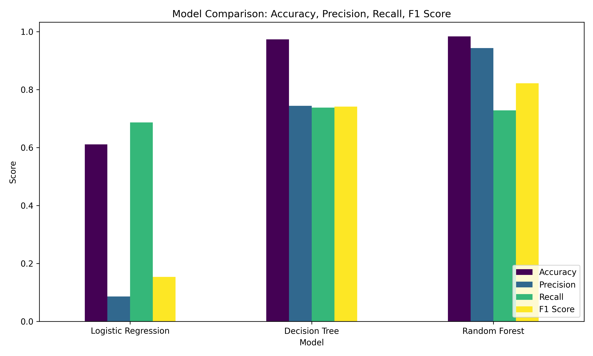
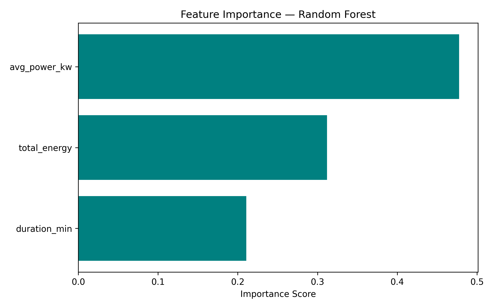
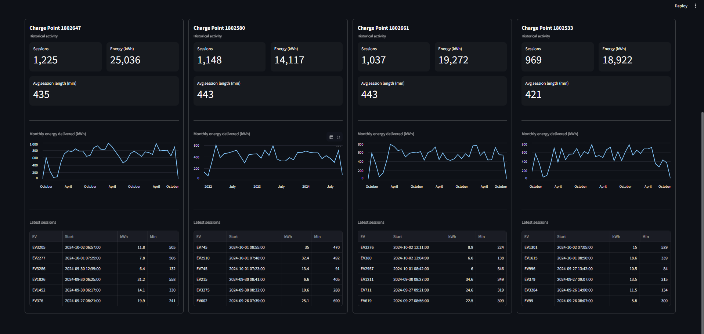
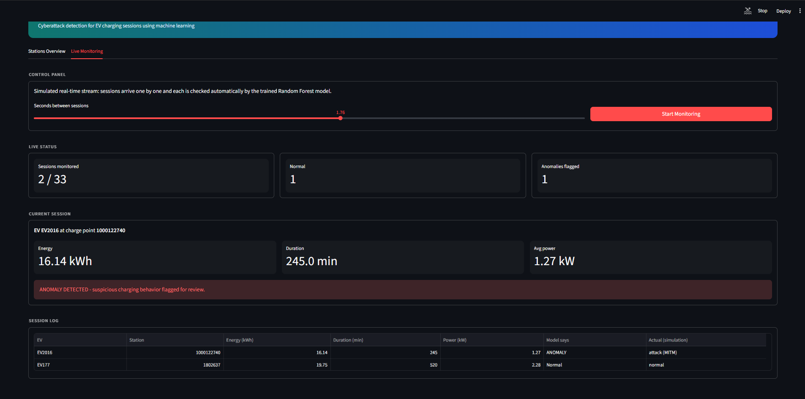

# EV Charging Cyberattack Detection

Machine learning based anomaly detection for electric vehicle charging sessions. The system flags charging sessions that look like False Data Injection (FDI), Distributed Denial-of-Service (DDoS) or Man-in-the-Middle (MITM) attacks, and includes a Streamlit dashboard that replays sessions as a simulated live stream.

## Problem
EV charging stations are internet-connected systems, which makes them a target for cyberattacks. This project detects abnormal charging behaviour from session data (energy, duration, power).

## Dataset
EV charging session data (55,379 sessions) from the a.s.r. office parking lot in Utrecht, Netherlands, collected 2020-2024 as part of the SmoothEMS met GridShield project (University of Twente, ElaadNL and partners). Published on 4TU.ResearchData under the CC BY-NC-SA license:
https://data.4tu.nl/datasets/80ef3824-3f5d-4e45-8794-3b8791efbd13

The data file is **not included** in this repository. Download it from the link above and place `202410DatasetEVOfficeParking_v0.csv` in the same folder as `app.py` before running the dashboard.

## Approach
1. Cleaned the data and engineered two features: `duration_min` and `avg_power_kw` (total energy / duration in hours).
2. Real labelled attack data is not publicly available, so attacks were **simulated** on 3,000 randomly sampled sessions:
   - FDI: energy inflated by 1.5-3x
   - DDoS: session duration cut to 30-50%
   - MITM: power multiplied by a random factor between -0.5 and 0.5
3. Trained and compared four models on features `total_energy`, `duration_min`, `avg_power_kw` (80/20 stratified split): Logistic Regression, Decision Tree, Random Forest, and an unsupervised Isolation Forest.

## Results (test set)
| Model | Accuracy | Precision | Recall | F1 |
|---|---|---|---|---|
| Logistic Regression | 60.96% | 8.62% | 68.67% | 0.153 |
| Decision Tree | 97.54% | 77.41% | 73.67% | 0.755 |
| Random Forest | 98.43% | 95.42% | 73.00% | 0.827 |
| Isolation Forest (unsupervised) | 92.92% | 30.73% | 30.17% | 0.304 |

Random Forest performed best. Average power was the most important feature.




## Dashboard
`app.py` is a Streamlit app with two tabs:
- **Stations Overview**: summary of the 4 busiest charge points in the dataset (historical data).
- **Live Monitoring**: replays sessions one by one; each is classified automatically by the trained Random Forest.




Run locally (after downloading the dataset, see above):
```
pip install -r requirements.txt
streamlit run app.py
```

## Limitations
- Attacks are **synthetic**, so results may not transfer to real-world attacks.
- The live monitoring tab is a **simulated stream** over recorded data, not a connection to a real charging station.
- Recall is about 73%, so subtle attacks can be missed.
- The data comes from a single office parking lot in the Netherlands, so charging patterns elsewhere (for example India) may differ.

## Future work
- Validate on real labelled attack data
- Replace the simulated stream with live data from a hardware test setup
- Add automated responses (alerts, session termination) after detection
